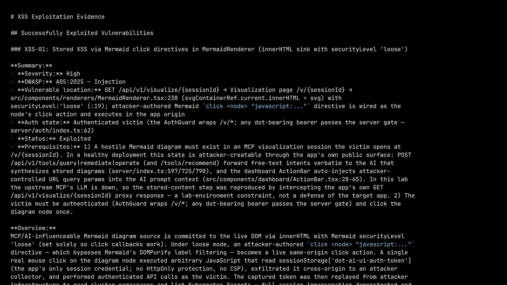

+++
title = "AI Pentesting Found Real Kubernetes Exploits in 3 Hours for $2"
date = 2026-10-12T15:00:00+00:00
draft = false
+++

A few hours of an agent's work, and a few minutes of mine. That's all it took to find a way into my own Kubernetes cluster. Not a maybe buried in a PDF. A real one, proven, with my session token stolen and my cluster's secrets read back out to an attacker. A human doing the same thing would have taken weeks, if I could even get one booked.

And if you're a developer, in DevOps or SRE, or anyone who ships software and has already decided security testing isn't your job, don't go anywhere. **This one's for you.** It's a way to offload the work you don't want to do, or never get around to, and still get findings back in a shape you can act on.

Here's the situation most of us are actually in. AI writes half our code now. Sometimes all of it. We ship faster than we ever have. And penetration testing, the thing that's supposed to catch the holes before someone else does, hasn't kept up. It's scarce, it's expensive, and it happens once a year, if it happens at all. By the time the report lands, you've shipped a dozen more releases, the version it actually tested isn't even running anymore, and half the findings are too late to fix cleanly. And what you get is usually a list of problems, not solutions. It's no wonder pentesters aren't most developers' favorite people to hear from.

So this video is about what changes when that pentester is an AI. I'm going to point one at an app I actually own, let it genuinely break in, and see what that's worth.

<!--more-->



<!-- Before publishing: fix the real dot-ai-ui bugs first (XSS-01, AUTHZ-01, MISC-01, all High). -->

## AI Penetration Testing

When the pentester is an AI, the real change isn't the testing itself. It's that you're no longer rationing a scarce, expensive consultant. It runs anywhere, on your own laptop or a CI runner, for a couple of dollars, so how often you run it is finally your call, not something you can afford only once a year. Run it when you're curious, run it on every release, run it on a schedule.

It reads your source code and attacks the running application at the same time. And here's the part that matters most. It doesn't just list what might be wrong. It tries to prove it. And once something's proven, an agent can pick up that report, file an issue for every finding, and start working through the fixes. **Find it, prove it, fix it**, all of it done by agents.


The tool I've been trying is called [Shannon](https://github.com/KeygraphHQ/shannon), from Keygraph, and it's open source. It's a single command. You can run it yourself, hand it to your agent, or wrap it inside a pipeline. It's simple, and that simplicity is a big part of what makes it good. It reads the source, attacks the running app, and reports only what it could actually exploit. That last part is the whole point. Most scanners hand you a long list of potential issues, and plenty of them turn out not to be exploitable, so you spend real time chasing findings that were never a real risk. Shannon leaves those out. If it's in the report, there's a working exploit behind it.

## Setup

Getting a target up is one command, and it's deliberately boring, because the target isn't the lesson. I pointed Shannon at an app I actually own, the dot-ai UI, running on a throwaway Kubernetes cluster, so that whatever it broke, it broke nothing that mattered.

```bash
git clone https://github.com/vfarcic/shannon-demo

cd shannon-demo

devbox shell

./dot.nu setup
```

This stands up a disposable kind cluster running the dot-ai UI as the target, reachable at http://dot-ai-ui.127.0.0.1.nip.io:8080, where you log in through the Token tab with `shannon-demo-ui-token`.

## Running Shannon


Here's the whole thing I ran against the target.

```bash
npx @keygraph/shannon@latest start \
  --url http://host.docker.internal:8080 \
  --repo $PWD/dot-ai-ui \
  --config shannon-config.yaml
```

It kicks off and echoes back what it's about to test.

```
Scan started — host-docker-internal_shannon-1789938539045
  Target:     http://host.docker.internal:8080
  Repository: dot-ai-ui
  Workspace:  host-docker-internal_shannon-1789938539045
  Config:     shannon-config.yaml
  Model:      openrouter:deepseek/deepseek-v4-flash-0731
```

From there it logs in the way a user would, then works through recon, finding vulnerabilities, and actually exploiting them, one class at a time. Injection, cross-site scripting, authentication, authorization, and server-side request forgery. It's powered by a language model, and it doesn't even need to be an expensive one, which is the whole reason this costs pennies instead of a salary. It runs in the background while I work on something else, or play games.


Any time I want to see where it's at, there's a status command.

```bash
npx @keygraph/shannon status host-docker-internal_shannon-1789938539045
```

It lays out every phase and where the time went.

```text
  Scan: host-docker-internal_shannon-1789938539045 partial · 3h 11m
  +  Authentication            42s
  +  Agentic SAST              2h 1m · concurrent
  +  Pre-Recon                 36m 33s
  +  Recon                     22m 41s
  x  Vulnerability Analysis    failed
       x auth              failed · This scan step could not be completed.
       ...
  x  Exploitation              failed
       x auth              failed · This scan step could not be completed.
       ...
  +  Reporting                 7m 8s
  Time Taken   3h 11m
  Why this scan is partial:
    - Authentication could not be fully assessed. The other classes completed.
```

And don't freak out about the red. That's not something I broke. The authentication agent just didn't finish on this run, and I'll get to what that means in a minute.

Three hours later, it was done. Three hours of its time, and a few minutes of mine. And the whole thing cost me **under two dollars**. So if you want to hire me to pentest your company, I'll happily do it for half of whatever the last person you hired charged you.

## Security Findings


Shannon didn't hand me a report, exactly. It generated a couple of them. One's a PDF, which is the format you hand a manager who'll pretend they read it and judge it purely on how big and colorful it is. The more pages and charts, the better; the content is beside the point. I'll skip that one. The other's markdown, and that's the one I want, because it's what I like and, just as importantly, what an agent likes. That second part matters here, because an agent is probably the one that's going to fix all of this. So I'll open the markdown, right there in the terminal.

```bash
cat ~/.shannon/workspaces/*/Security-Assessment-Report.md
```

It's a long report, but the summary up top is the part that matters.

```md
...
## Summary by Vulnerability Type

### Injection

- **INJ-01:** OAuth callback redirect_uri built from unvalidated Host header on /auth/login (Low)
- **INJ-02:** Client authentication gate accepts forged unsigned JWTs (insecure deserialization) plus server dot-token pass-through (Low)

### XSS

- **XSS-01:** Stored XSS via Mermaid click directives in MermaidRenderer (innerHTML sink with securityLevel 'loose') (High)

### SSRF

- **SSRF-01:** Unauthenticated /api/debug discloses internal MCP base URL and upstream token presence (Low)

### Authorization

- **AUTHZ-01:** Static-token UI user inherits full MCP service-account privileges via getUpstreamToken fallback (High)

### Miscellaneous

- **MISC-01:** Session bearer token stored in plaintext script-readable sessionStorage (dot-ai-ui-auth-token) (High)
- **MISC-02:** Tool and user-management authorization is client-side only, never enforced server-side (Medium)
- **MISC-03:** GitHub 'Report Issue' URL embeds raw MCP diagram content and error text (errorReporting.tsx) (Medium)
...
```

And it's not a wall of maybes. It's eight findings it actually exploited, each with a working proof, and that's a lot for an app this small. Three of them are rated High: a stored cross-site-scripting bug, a static-token user that inherits full cluster privileges, and the live session token sitting in script-readable storage.

The one that stopped me is that first one, the stored cross-site-scripting bug, and it's in how the UI renders diagrams. One click on a diagram, and an attacker's code runs inside my app, reads my session token straight out of the browser, and uses it to impersonate me against the cluster. Shannon didn't just flag that as possible. It did it, in a real browser, then replayed the stolen token to read back namespaces and secrets it should never have touched, and wrote the whole chain into the report. One caveat worth stating plainly: the demo's AI backend is a stub, so I placed the malicious diagram directly instead of coaxing it out of a real model. Everything after that, the click, the code running, the stolen token, the cluster reads, Shannon did for real.



None of this is magic, though. It's slow. It's non-deterministic, so two runs won't turn up exactly the same things. It leans hard on the model you give it. This run actually came back marked partial, because **one whole class of attack went untested**: authentication failed to finish. The findings themselves, though, are solid. Every one came with a working exploit, so there's nothing to triage or second-guess before an agent starts fixing them.

## AI vs Human Pentesters

But here's where it gets genuinely useful. The report is the start, not the end. Normally I'd hand it straight to a coding agent, a different agent from the one that did the testing, and let it work through the report, open an issue for every finding, and start on each. I don't come back to a report. I come back to pull requests that close the issues. And where I used to triage down to the ones that really mattered, fixing all of them now falls squarely into "why not?" territory. The pentester finds. The coder fixes.

And once that loop works once, there's no reason to run it once a year. You schedule it. Shannon drops into a CI pipeline, runs on every release, or just weekly, and files what it finds automatically. And from there, opening those issues can trigger the fixing agents on its own, so a finding turns into a pull request without me touching anything. Security that tests itself and fixes itself, release after release, or on whatever cadence you set, instead of an annual event you dread.


Could you do all of this without Shannon, by handing a pile of skills to a general-purpose agent? Maybe. Maybe not. Maybe after a lot of work. But the real question is why you'd bother. Shannon is open source and free; the only thing you pay for is the model. So use it. Think of it as an agent dedicated to pentesting, one you run directly, or hand to whatever agent you're already working with. And if it earns its keep and you want it running continuously across a team, wired into your tickets, with the dashboards and compliance a company needs, Keygraph, the company behind it, sells a hosted platform for exactly that. But the part that does the actual breaking-in is the free part.

So is this going to replace human pentesters? No, and that's the wrong question. A human still catches what this missed and brings judgment the model doesn't have, and nothing here stops them. It just takes the routine sweep, the slow, expensive grind that never happens often enough anyway, and hands it to an agent for pennies. The pentesters we have aren't replaced. They're freed for the hard, critical paths. A few hours of an agent, a few minutes of me, and a couple of dollars a run. **Nobody gives up anything that matters.**

## Destroy

When I'm done, one command tears the whole thing down.

```bash
./dot.nu destroy
```

The report stays under `~/.shannon/workspaces/`.
