+++
title = "How I Manage AI Agents at Scale (Prompting Is No Longer the Problem)"
date = 2025-11-09T15:00:00+00:00
draft = false
+++

Agents that manage agents, and those agents manage workers of their own. That's how most of my work gets done these days. And the whole team is made entirely of disposable context windows.

That last part changes everything. With one agent, I write a prompt. With dozens, prompts stop being the problem. The problem becomes what each agent is allowed to know. Who keeps the plan. Who sees the logs. Who starts with a clean slate. That is the same problem every manager has, and it turns out to be most of what makes a large agent team work.

That is what this video is about: how the way we instruct agents changes as we give them more autonomy, more work, and more responsibility. By the end, we will get to where I think this is going next: systems that decide how much organization each task actually deserves.

<!--more-->



## Setup

> Install [Agent Deck](https://agent-deck.devopstoolkit.ai/docs/installation). The examples use the project's existing `.dot-agent-deck.toml`, repository instructions, and skills. Reproducing the exact issue queue requires that project-specific configuration.

```sh
dot-agent-deck
```

## Coding Agent Autonomy


I started with one agent I had to approve at every step. Today, I run dozens of them across three machines, and I walked through how I got there in [How I Manage 45 AI Agents Across 3 Machines](https://youtu.be/aTB4Iou5YfU). That trust didn't come for free. I spent a lot of time writing instructions and skills that fit my projects and the way I work, until the agents got things right often enough that approving every step became pointless. The pipeline catches whatever still slips through. This video is about what happens inside a team like that: who knows what, and who decides what.

Trusting agents doesn't mean letting them decide everything. Leaving them alone forces a different question: which decisions belong to agents, and which belong to everything around them?

If I want agents to keep going without me, they have to own the decisions I used to make every time something went wrong. Why did the test fail? Is the problem in the code or in the test? What should they try next? If those questions keep coming back to me, **I'm not delegating. I'm micromanaging.** So agents should decide why a check failed and how to make it green. What they don't get to decide is whether a required check matters. That's the one decision that would let them declare victory on broken code. A red check means the work isn't done, no matter what the agents think.

Agents can follow a strict workflow, or they can find their own path through the problem. Usually, it's a mix of both, and, just like with people, both extremes fail. If the workflow is too rigid, agents follow it whether it makes sense or not. If there's no workflow at all, they do whatever they want. So I keep the rigid parts for outcomes that are non-negotiable, like required checks, and leave agents free wherever their judgment adds value.

Once my agent could own those decisions, I stopped stepping in after every attempt. It decides what a change needs. A code change might mean implementing, testing, inspecting failures, and trying again, as many times as it takes. A fix to a typo in the docs doesn't need any of that. What it can't skip is the process around the change. It doesn't push directly to main. It opens a pull request, and the checks there run whether it thinks they're needed or not.

But the same context was still doing everything. It contained the original request, repository exploration, implementation decisions, failed hypotheses, logs, test output, review comments, and every repair attempt. Eventually, the context fills up and the agent compacts it, summarizing what happened so far and dropping the details. That is not a disaster. Modern agents recover from it surprisingly well. But stuffing every detail into one conversation is still a wasteful way to use context.

The next step was not a better prompt. It was separating the work.

## AI Agent Context Management

Think about what a human manager does. They keep the objective and the constraints. They break a project into tasks and decide what can happen in parallel. They give each person the context needed for their assignment. And they get summaries back, instead of sitting beside every employee for every keystroke.

The manager does not need the entire debugging history from every developer. They need to know what was decided, what changed, what evidence supports it, what remains unresolved, and what should happen next.


Everything in this video is about principles, and they apply whether you use the tool I'm about to show you, another one, or a handful of agents and your own scripts. What you're about to see is [Agent Deck](https://agent-deck.devopstoolkit.ai), the open-source app I use to run all of those agents. If you want to try it, the link is in the description, and if you find it useful, star it on [GitHub](https://github.com/vfarcic/dot-agent-deck). It helps more people find it.


An agent orchestrator should keep the same things in its context as a manager does. The goal. The plan. The current state. Decisions. Delegations in flight. Results. Evidence. Open questions. Not fifty thousand tokens of compiler output from a worker that already fixed the problem.

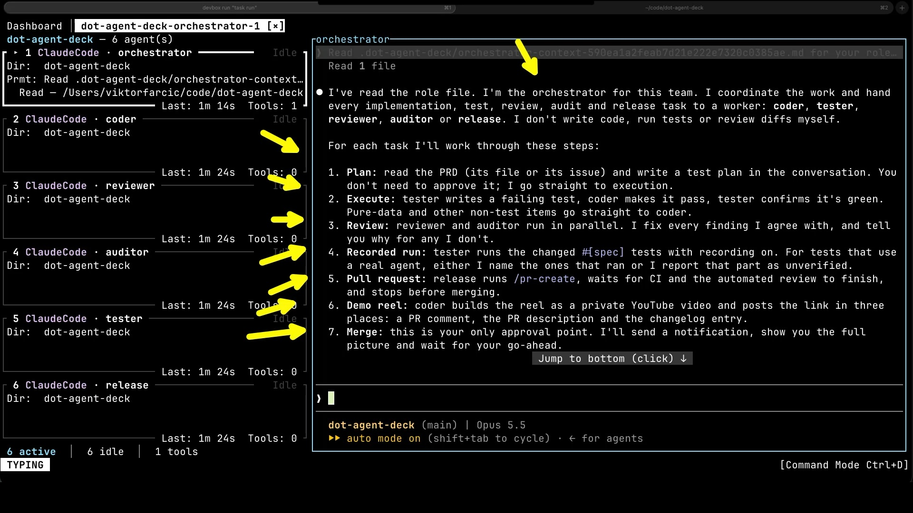


So the orchestrator stays for the whole task. The detailed work goes into disposable contexts. The orchestrator delegates one bounded operation. The worker starts fresh, receives only the relevant brief, performs the work, and returns a concise result. The next delegation can start from another clean context.

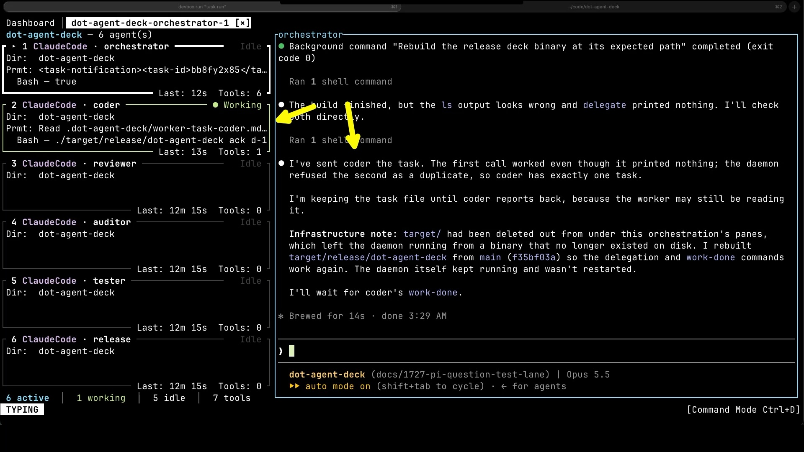

This is why I call those agents specialized. The important specialization is not the job title. It is the context. A coder receives implementation context. A tester receives the behavior that must be demonstrated. A reviewer receives the requirements and the resulting diff, but not the long conversation that convinced the coder its approach was brilliant.

## AI Code Review with Fresh Context

Separating contexts changes the quality of the result.

A single agent usually implements the task once and then evaluates its own work from inside the same reasoning trajectory. If it misunderstood the requirement, its tests and self-review can easily preserve the same misunderstanding.


With a team, the coder implements the change and reports back to the orchestrator, which brings in a reviewer with a fresh context to try to break the argument. The reviewer reports findings to the orchestrator. The orchestrator sends accepted findings back to a fresh coder context. The code changes, the reviewer looks again, and the loop continues.

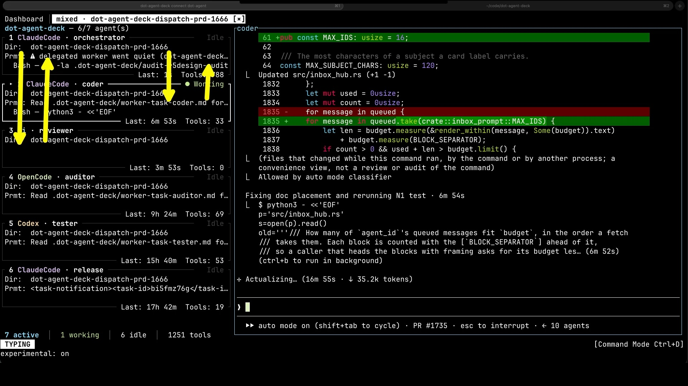

The tester provides a different kind of independence. In my current workflow, the coder owns production code and its unit tests. A separate tester owns functional and end-to-end behavior. The tester knows what the feature should do, but does not inherit the coder's explanation of why the implementation must already be correct.

Either agent can be wrong. Two agents can be wrong together. They can even waste time arguing about style. A disagreement becomes valuable only when it ends in stronger evidence: a reproducer, an executable test, a requirement, a repository invariant, or a product decision from a human. A reviewer label is not evidence. A passing check is, and even that proves only what the check actually covers.

That is why the orchestrator is not just a message router. It decides whether a finding is valid, asks for evidence when it is not clear, and escalates when the disagreement is really an unresolved product decision.

I pick a model for each role partly by what it's good at and what it costs. But there's a second reason to mix them. I prefer different model families for roles that should challenge each other. A coder and a reviewer running the same model tend to share the same blind spots. Agents on the same model are closer to clones than colleagues. Different models are not truly independent either. They learned from much of the same material, and they read the same repository. But they raise the odds of a genuinely different interpretation. That matters most for architecture, security, concurrency, and anything else where several answers can look reasonable.


All of this is slower than asking one agent to take one pass, and more expensive. Research comparing a team of agents with a single agent at the same inference cost mostly doesn't show teams winning, so be skeptical of anyone claiming a swarm is inherently more intelligent. But equal cost isn't the question I'm asking. Cost and time matter to me, but quality matters more. I'm deliberately spending more, on additional attempts, fresh perspectives, and independent verification, because in my experience that's what produces better software on complex work. Could one agent spend the same extra budget just as well? Maybe. But it would spend it inside one context, reviewing its own reasoning. And since I'm not the one watching, the extra time barely matters.

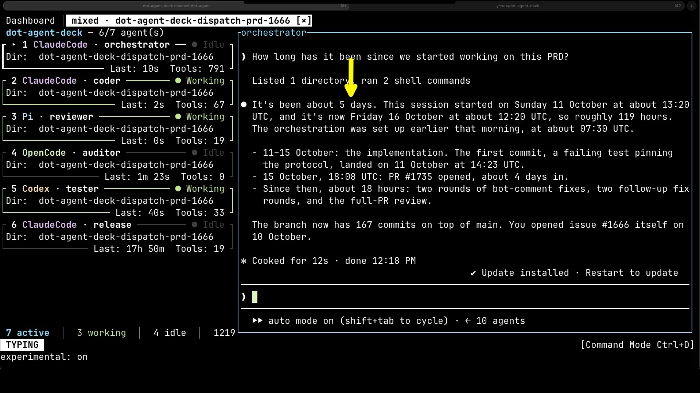

The manager analogy stops there. Human managers can rely on tacit knowledge, shared culture, relationships, and people remembering what happened last month. Agent orchestrators cannot. They need artifacts.

Plans, task files, commits, tests, pull requests, CI results, and decision records are the organizational memory. If an orchestrator compacts, it can read them. If every process crashes, I start another orchestration in the same worktree. The agents can resume their sessions, but they don't depend on them. They reconcile what Git, pull requests, and CI actually show, and carry on. Some runtime bookkeeping might need to be rebuilt. The engineering work is not trapped inside one irreplaceable process.

A human organization survives because its knowledge is not stored entirely in one manager's head. An agent organization should work the same way.

## Managing Parallel AI Agents

An orchestrator manages one task. It has nothing to say about what happens between tasks. Someone still has to choose the next one, prepare an isolated environment, decide whether it needs one agent or a team, start it, monitor it, and keep the machine busy. If that someone is me, **I am still the scheduler**.


That is where the dispatcher comes in. It is a manager of managers. It does not implement issues. It manages the portfolio.

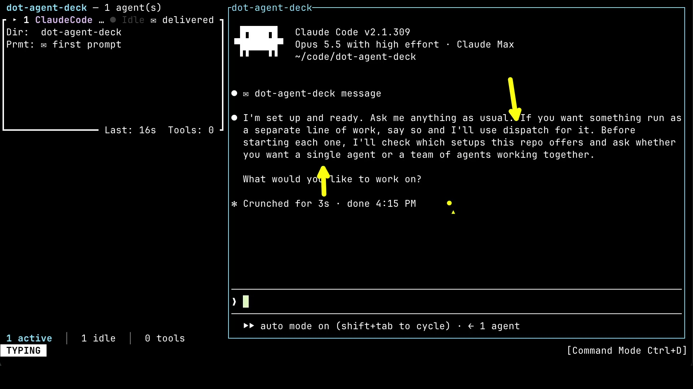

With agents, a zero-issues policy becomes possible, at least in theory. The moment a problem is found and filed, it gets fixed. The moment I write down an idea, agents start working on it. What stops me isn't the agents. It's cost, capacity, and me. I have neither unlimited hardware nor unlimited tokens, and even if I had both, I couldn't review everything they would produce.


So the dispatcher works within those limits. It fills each free slot as soon as one finishes. The interesting part is how it decides what goes into that slot. Which issue goes next matters less than it seems, since all of them should get done eventually. What matters more is whether an issue is ready to be worked on at all. A skill in the repository defines what that means for this project. The dispatcher fetches the current backlog, removes PRDs and issues that are already in flight, checks for duplicates and coupled work, verifies that an issue's premise is still valid, and claims each issue before dispatching it.

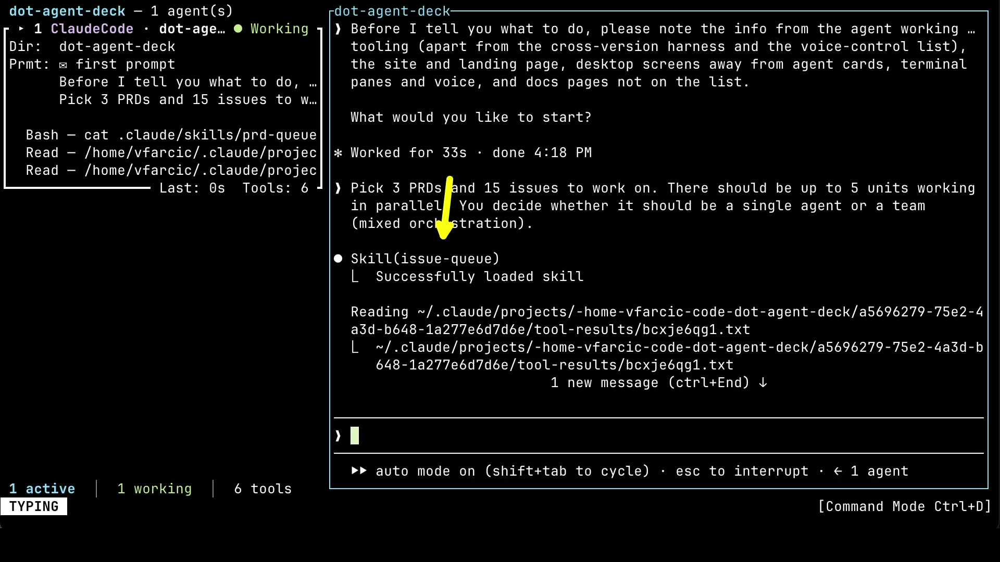


That selection work goes only as deep as the decision needs. The dispatcher reads the issue and inspects the relevant source code to judge how complex the work is and whether it divides cleanly. That is enough to decide how the issue should be executed. It does not design the fix or fill its context with implementation details. Those belong to the issue unit.

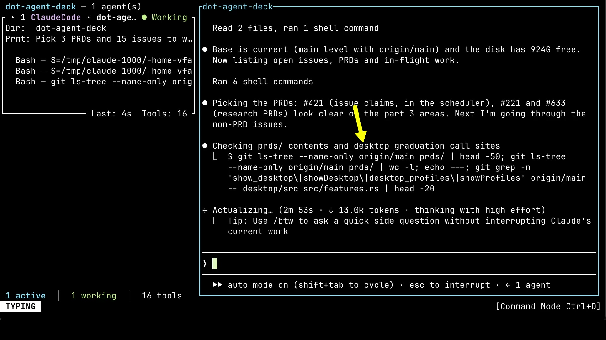


For each selected issue, it chooses between one agent and a team. The criterion is not simply size. It is divisibility.

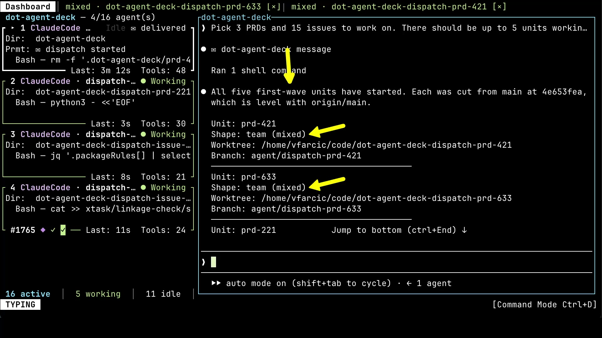

A change concentrated in one tightly coupled area usually gets one agent, even when it's large. Splitting it would create coordination without creating useful parallelism. A complex change that separates cleanly into implementation, behavioral testing, and review gets a team. When the decision is close, one agent wins.


Every issue gets its own branch and worktree, and that worktree is the actual unit of parallelism.

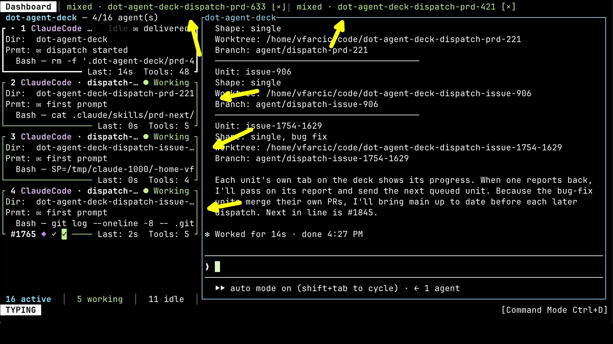

A team unit starts its own issue-level orchestrator, which can hand work to any available worker, including several at once.

Parallelism inside one worktree still takes judgment. A reviewer and an auditor can look at the same change at the same time. Neither of them writes anything.


A coder and a tester can also work side by side, as long as they own separate parts of the plan and don't step on each other. And separate means more than different files. They still share Git state, build output, services, and test fixtures. Parallel work needs effects that don't collide, not just different filenames.

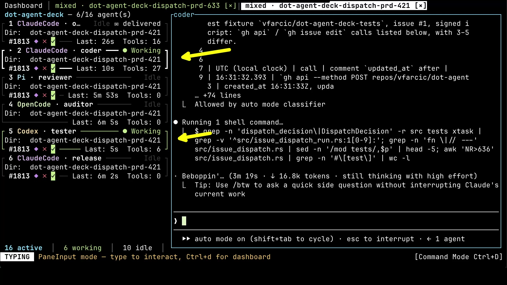


When a unit completes, only its report returns to the dispatcher. This hierarchy keeps each context focused. The day-level dispatcher knows the queue and the outcomes. Each issue orchestrator knows one issue. Each worker knows one operation. The details move downward only when needed, and concise evidence moves upward when the work is done.

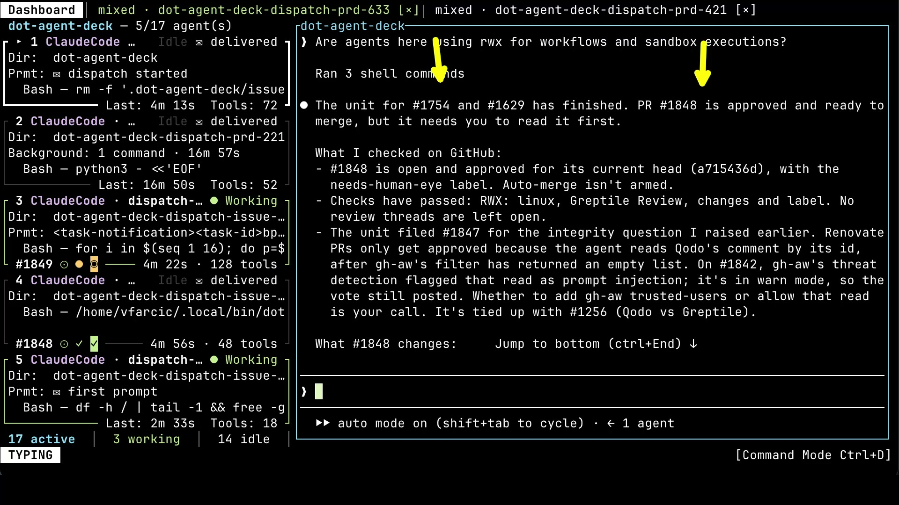

At that point, I am no longer managing conversations. I am managing capacity, priorities, exceptions, and outcomes.

## Rules vs Best Practices for AI Agents

So what should agents follow, and what should they decide for themselves? I think about it in three layers, and they apply to agents almost as much as they apply to people.


First, there are a few things that **must happen** no matter what. In my projects, there are two. Changes go through a pull request, and a pull request doesn't merge until the required checks are green. Yours might differ, maybe a security scan, or a human sign-off for anything that touches payments. What they have in common is that agents shouldn't be the ones deciding them about their own work. And that list has to stay short. A good test is whether a rule needs an "unless". "Always run the tests" sounds reasonable until the only change is in the docs. Then it becomes "unless it's docs", then "unless it's a config change", and soon you're trying to list every permutation. If a rule needs exceptions, it probably isn't a rule. And if it's something we keep finding ways around, it's worth asking why. Sometimes it's just inconvenient, and it should stay. More often than we'd like to admit, it's a stupid rule.

Second, there are **best practices**. Plan before you code. Get a review. Show the behavior a user will see. They are valuable most of the time, but not all the time, and whoever knows them well also knows when to skip them. They also depend on who does the work. Nobody tells an experienced engineer to plan before coding, but we might want to see a plan from a junior before they touch anything. And they don't last forever. I followed most of the Gang of Four design patterns at one point. Today, I rarely reach for them. Planning went through both changes with agents. I used to force them to plan all the time. Today they plan by default, and I rarely bother. A practice that had to be spelled out last year can be noise today. So be prepared to review, measure, and update best practices continuously, or they might do more damage than good.

Third, there is **local experience**. In this project, we do it this way, for this reason. Models already have plenty of general experience. They have seen more codebases than any of us. What they don't have is knowledge of this repository, this team, and what went wrong last month.

## Writing Instructions for AI Agents

The trouble is that agents don't read instructions the way people do. A person reads a runbook and quietly skips the step that obviously doesn't fit. To an agent, an instruction looks like a rule. I learned that with a step that produced a demo video for every task a team worked on. It made sense for features, and none for a change with nothing to show. The workflow handled that with an exception: skip the demo when no end-to-end tests changed. That's the "unless" trap again. What works better is stating why a practice exists. A demo exists so a human can see a change in behavior before merging. An agent that knows that can decide that a research task doesn't need one, without anyone listing that case in advance. **Reasons cover the cases nobody thought of.** Exceptions cover only the ones someone did.

Agents fail in the other direction too. They cut corners when a rule gets in their way. The answer isn't more rules. It's more than one agent. When a coder cuts a corner, a reviewer with a fresh context is likely to object, especially one running on a different model. And when they all miss the same thing, the required checks are still there.

Local experience has its own dangers. It's tempting to copy whatever an organization already does. Some of those practices exist to compensate for human limits and make no sense for agents. Others were never good, and people simply worked around them without saying so. Agents can't work around what nobody wrote down, so they follow a bad rule faithfully, and at scale. At the same time, agents need practices no human organization ever had, like a fresh context for every review, or plans and decisions written down because nothing is remembered between sessions. And local experience piles up. Every incident adds a rule, and nothing gets removed. Writing down the reason is what makes removal possible. When the reason no longer holds, the practice goes.

That is why Agent Deck itself is deliberately not very prescriptive. It provides mechanisms: start a process, clear its context, delegate a task, run several roles, isolate work in a worktree, observe status, and route results. It does not know how your project tests software, whether you use pull requests, or which decisions require a human. Project-specific skills supply that policy. A command-line tool, a Kubernetes controller, and a documentation site need different tests, different reviews, and a different definition of done, so each repository defines its own organization without changing the application.

That's the balance I'm after: not autonomous agents escaping process, but adaptive agents operating inside a process whose hard edges they cannot negotiate away.

## Future of Coding Agents

What comes next is a system that decides how much organization each task deserves. Not one enormous agent with an enormous context, and not a permanent fake company where six personas attend every meeting. Start with one agent. An uncertain concurrency bug might need two independent investigators. A security change might need a second auditor on a different model. A typo needs nothing more than the first one. Add a context only when it brings something the first can't: a clean perspective, independent evidence, parallel capacity, or meaningfully different judgment. My job becomes designing that organization: the few rules that can't bend, the practices and the reasons behind them, and the points where a human has to decide.

So here's my question for you. Which decisions are you still making for your agents that they could make themselves, and which ones should they never make at all? Let me know in the comments.

Once agents are doing more work than one person can personally supervise, **prompting is no longer the main problem**. Management is.
