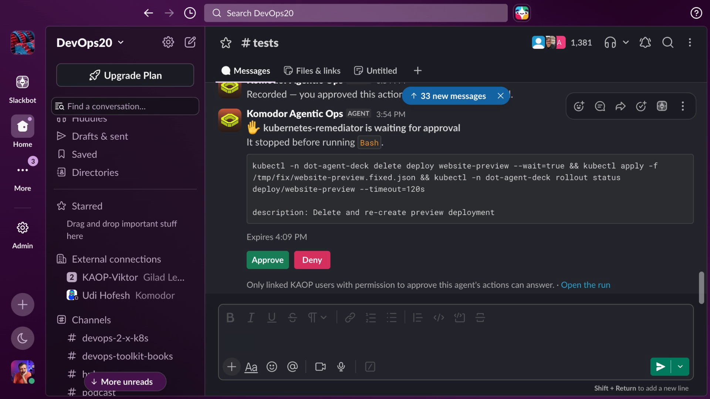

+++
title = "AI Agents in Kubernetes Without Laptop Credentials (feat. KAOP)"
date = 2026-11-16T16:00:00+00:00
draft = false
+++

Why would anyone put a platform between an AI agent and a Kubernetes cluster? Claude Code can fix clusters on its own. It finds the cause, rules out the red herrings, changes only what it should, and verifies the fix. No platform, no special setup. Just a terminal, a prompt, and my credentials. That works for one person. Does it work for a company, where it means every laptop holding the keys to production, nobody else approving what the agents change, no shared record of what they did or what it cost, and nothing happening unless someone sits at a keyboard?


To find out, I tried a platform built for exactly that: [Komodor](https://komodor.com)'s Agentic Operations Platform, KAOP for short. It lets you define agents and run them inside your clusters instead of on someone's laptop, as services with their own identities. It sends their risky actions to people for approval, and it keeps a record of what they did and what it cost. It does more than that, like a catalog of ready-made agents, guardrails on the tools agents call, and side-by-side testing of a new model or prompt against the current one, and I'll come back to those at the end.

So, do we need a platform at all? What changes when there is one? And is KAOP the one to pick? To answer that, we'll fix the same incident four times: with Claude Code alone, with Claude Code going through KAOP, and twice with nobody at a laptop. One of those fixes goes wrong in a way that says something about agents in general, not only about KAOP.

<!--more-->



> **Clip legend.** `[screen]` is a screen recording, either a terminal on pure black or a browser page. It plays once and never loops. Hold on the final frame rather than cutting mid-output. `[transition]` is a section card or the end card: insert it at the cut into its section (the end card after the last spoken line), opening a gap, and never lay it over narration. Clips 04 and 06, and 18 and 20, are each split from one take: the Slack clip between them (05, 19) happened while Claude Code was waiting. All clips are in `material/kaop/`, recorded 2026-10-23 on the Agent Deck website; the raws and the re-time recipes are in `material/kaop-raw/`. Clip 03 (the site fixed) is no longer used; it stays on the Drive in case it comes back. Every Slack approval, the Slack mention, and the replies typed into Claude Code ("Check it through KAOP.") were done by Claude on Viktor's behalf, on the demo environment, during an end-to-end run.

## Setup

```sh
git clone https://github.com/vfarcic/kaop-demo

cd kaop-demo
```

> Watch [Nix for Everyone: Unleash Devbox for Simplified Development](https://youtu.be/WiFLtcBvGMU) if you are not familiar with Devbox. Alternatively, you can skip Devbox and install all the tools listed in `devbox.json` yourself. Two tools are not in it and must be on your machine already: Docker (kind runs the cluster in it, and two images are built locally) and Claude Code.

```sh
devbox shell
```

Sign up for KAOP at https://komodor.com/free-trial, create an API key under **Settings → API keys** (it acts as you), and connect Slack under **Settings → Integrations → Slack** (one workspace). Pick a channel for approval requests and run reports, and add KAOP's app to it. `setup.sh` also brings dot-ai, my own agent mentioned in the pros, into KAOP, and dot-ai calls Anthropic with its own key.

[user]
```sh
export AGENTOPS_API_KEY=[...]

export SLACK_CHANNEL_NAME=[...]

export ANTHROPIC_API_KEY=[...]
```

```sh
./setup.sh
```

> `setup.sh` creates a kind cluster with port 80 mapped to the laptop and Traefik as its ingress controller, and deploys the Agent Deck website (the project's own site, built from Agent Deck v0.47.1 into `ghcr.io/vfarcic/komodor-demo:0.47.1`) at http://dot-agent-deck.127.0.0.1.nip.io (nip.io resolves that name to 127.0.0.1). It installs KAOP's read-only Kubernetes RCA, the Kubernetes Remediator (an agent that can change the `dot-agent-deck` namespace, limited by Kubernetes RBAC) and dot-ai, sets the approval rules (any `kubectl` command that changes something waits for you in Slack), connects the Slack channel, creates a disabled five-minute health-check schedule, adds KAOP to Claude Code in `../kaop-runs/claude-code-kaop` only, and breaks the website. It asks for anything not exported above, and pauses once if Claude Code hasn't signed in to KAOP yet (`/mcp` in that directory). It's safe to re-run.

> Using a different agent? KAOP is a remote MCP server (HTTP, OAuth), so any agent that supports remote MCP servers can connect. The console's **Settings → Connect coding agents** has ready-made commands for Codex CLI and Cursor; for others, add the same URL in that agent's own MCP config. Only Claude Code was tested here.

> Each section below breaks or fixes the website, so start each one from a fresh incident with `./incident.sh` from the repo.

```sh
cd ../kaop-runs/claude-code
```

## Claude Code Fixes Kubernetes Alone


Let's start with the incident. There's a website running in a Kubernetes cluster, and visitors say it sometimes fails. I'll reload it a few times.


What you're looking at is the website of [Agent Deck](https://agent-deck.devopstoolkit.ai), a project of mine. Agent Deck runs your coding agents under one background daemon and shows you what each of them is doing, in a terminal or in a desktop app, so you stop babysitting one agent and start running a team of them. Back to the site. Most reloads show its landing page. Every few, though, the page is blank except for "preview build", and that's an HTTP 500. It's broken, but only sometimes, which is the worst kind of broken. Let's try to fix that.

> Claude Code uses your default model and permission mode. Here that's Opus 5.5 in auto mode, which runs most commands without asking and stops on risky ones. It gets the cluster through `KUBECONFIG`, which Devbox exported.


First, the way most of us would do it today, unless you still live in La La Land, convinced that LLMs and agents are a passing fad. I'll start Claude Code on my laptop, which holds the cluster's credentials.

```sh
claude
```

We know how the issue manifests, but not what's causing it, so that's all I'll tell it: the website sometimes fails.

[user]
```text
Visitors report that the dot-agent-deck website sometimes fails. It runs in the dot-agent-deck namespace. Do a full analysis: what is failing, why, and how to fix it. Then apply the fix and verify that the website works.
```

Now it goes to work. Watching an agent run `kubectl` command after command isn't exactly gripping, so I'll fast-forward through that part, and through every other wait like it in this video. After a minute or two, this is what it came back with.

[agent]
```md
...
The website is fixed: 100 out of 100 requests through the ingress now return 200, as do 60 out of 60 sent from inside the cluster.

**What was failing:** About a third of requests to `dot-agent-deck.127.0.0.1.nip.io` got an HTTP 500. The in-namespace `visitor` pod's log showed 200s and 500s mixed in a random-looking pattern. The real website pods logged only 200s, so the 500s were coming from somewhere else.

**Why:** The `website` Service selected pods by `app=website` only. The docs-team created a `website-preview` Deployment ("Preview of the redesigned landing page. Not exposed to visitors yet.") and gave its pods the labels `app=website, track=preview`. That pod runs `hashicorp/http-echo` with `-status-code=500`. Because it matched the Service selector, it became the third endpoint alongside the two real nginx pods, and the Service spread traffic across all three.

Two things I ruled out:
- **The recent `website` rollout (revision 2):** it was only a `kubectl rollout restart`, with the same spec as before.
- **The crash-looping `newsletter` pod:** it can't reach the SMTP relay `mail.internal:25`. That's a separate problem and doesn't affect the website, so I didn't change it.

**What I changed:**
1. I added the label `track: stable` to the pods of the `website` Deployment. Its own selector is unchanged, and the rolling update kept the site up.
2. I changed the `website` Service selector to `app=website, track=stable`. Now it routes only to the two nginx pods, and the preview pod is no longer an endpoint.

I left the docs-team's preview Deployment running, untouched; it just no longer gets public traffic. The `visitor` pod's log now shows only 200s.
...
```

It fixed it. I'm not here to tell you to use agents. You already do, so an agent finding and fixing a problem like this is magic you're used to by now, and there's nothing for me to explain.

This worked only because my laptop is an admin on that cluster. In most companies a developer's laptop does not, and should not, hold admin credentials to production, and that's the gap KAOP claims to fill.


[user]
```text
/exit
```


```sh
cd ../../kaop-demo

./incident.sh
```

I broke the website again for the next section.

## Claude Code with Komodor KAOP


KAOP is a control plane for agents. The agents themselves run in your clusters, as workers that connect out to Komodor, so nothing in those clusters has to accept incoming connections. Each agent has its own identity and its own permissions.

KAOP has its own console, with its own chat, and you could do everything from there. I won't. I already have an agent I like, and you have yours, be it Claude Code, OpenCode, Codex or something else. A platform that makes me use its interface to reach its agents is like a shop that only lets me in through its own browser instead of Chrome. KAOP doesn't do that. Pretty much everything it offers is also available over MCP, so I'll stay in Claude Code.

I already set up the Kubernetes Remediator, its permissions, the approval rule and the Slack channel. In a company, that would be the platform team's job; a developer only adds KAOP's MCP server to their agent.

There are two agents for this cluster. Kubernetes RCA comes from Komodor's catalog, and it can only read. The Kubernetes Remediator is one I built on Komodor's agent base, and it can change things, but only in a specific namespace. Building it was a Helm chart with a few values, mostly instructions telling it what it's for, plus a regular Kubernetes Role that limits what it can touch. The approval rule is a short policy: any `kubectl` command that changes something waits until a person approves it in Slack. None of that is worth watching, so I'm skipping it.

You might say Claude Code can do the same. Its permission rules can ask before any `kubectl` command that changes something, and a company can enforce those rules for everyone. True, but that only decides what the agent may do. The credentials are still on the laptop, so whoever drives the agent can run `kubectl` themselves. The approver is always whoever sits at that terminal, the approval is a keypress nobody else sees, and the rules apply only while someone is there to drive. With KAOP, the access belongs to the agent running in the cluster, and my laptop has none, so there's nothing for me to go around. The person who says yes can be someone else entirely, and every answer is recorded in one place.

> All of it was created by `setup.sh` in Setup: the Remediator (`helm/kubernetes-remediator.yaml`, with `kubectl` added in `remediator/Dockerfile`), its Role (`k8s/remediator-rbac.yaml`), the approval rule (`kaop/kubernetes-remediator-permissions.json`), the Slack route and sink, and the schedule used later (all in `kaop/`). Read those files to see how little there is.

> If KAOP's approvals don't ask you, check that your account has the `actions_approvals` flag. Before Komodor turned it on for this account, the Remediator ran its writes without asking anyone.


```sh
cd ../kaop-runs/claude-code-kaop

export KUBECONFIG=$PWD/kubeconfig.yaml
```

> `kubeconfig.yaml` doesn't exist in this directory, so the `export` leaves Claude Code without a cluster. `setup.sh` also gave the directory deny rules for `kubectl`, `kind`, `docker`, `helm` and kubeconfig files.


Now let's do it again, this time from a Claude Code session that has KAOP connected over MCP and no access to the cluster at all.

```sh
claude
```

First, proof that this Claude Code has no way into the cluster.

[user]
```text
! kubectl --namespace dot-agent-deck get pods
```

```
E1023 15:39:21.263029   76274 memcache.go:265] "Unhandled Error" err="couldn't get current server API group list: Get \"http://localhost:8080/api?timeout=32s\": dial tcp [::1]:8080: connect: connection refused"
...
The connection to the server localhost:8080 was refused - did you specify the right host or port?
...
kubectl is falling back to `localhost:8080`, which usually means it found no kubeconfig or no current context. Let me check which one.
I couldn't check your config myself because the inspection command was denied, so this is from the error alone.
...
Paste the output and I'll tell you which fix applies.
```

`kubectl` has nowhere to go, and Claude Code isn't allowed to look for credentials either.

Now the same request as before, word for word.

[user]
```text
Visitors report that the dot-agent-deck website sometimes fails. It runs in the dot-agent-deck namespace. Do a full analysis: what is failing, why, and how to fix it. Then apply the fix and verify that the website works.
```

This time there's more going on behind that spinner, so the fast-forward skips a few minutes.

[agent]
```md
Local kubectl is blocked here, so I'm routing the investigation through the KAOP agents. First up is an RCA run from the in-cluster agent (Kubernetes RCA, kaop).
...
The Remediator is applying the fix and running its checks (including a 60-second wait on visitor traffic). I'll report back when it finishes.
```

I never mentioned KAOP. Claude Code found that its own `kubectl` was blocked, looked at the tools it had, and found KAOP's agents. It sent Kubernetes RCA to investigate and the Remediator to fix it, then moved the wait into the background and said it would come back.


Meanwhile, every `kubectl` command the Kubernetes Remediator wanted to run that matched the `ask` rule waited in Slack. Two in this run, approved one by one:

I read each request before approving it. The first is mostly harmless, a backup and a dry run, but it contains `kubectl apply`, so the rule caught it. The second is the actual fix.



When the run finished, Claude Code came back on its own:


[agent]
```md
The site is fixed and verified. About 1 in 3 requests were returning HTTP 500, and every request checked since the fix has returned 200. Local `kubectl` was blocked in this session, so the in-cluster KAOP agents ran everything: Kubernetes RCA did the analysis and Kubernetes Remediator applied the fix.

**What was failing:** The `website` Service sent traffic to three pods. One of them was a preview pod that answers every request with HTTP 500.

**Why:** A `website-preview` Deployment was created at 13:37:01 UTC. Its pods carried the label `app=website`, which is the only label the `website` Service looks for. So the Service treated the preview pod (`hashicorp/http-echo` with `-status-code=500`) as a third copy of the site. Its own annotation says "Not exposed to visitors yet", and it was owned by `docs-team`.
...
**Fix applied:** The Remediator changed the preview's `app` label from `website` to `website-preview`. That field can't be edited in place, so it deleted and re-created the Deployment with the new label. Everything else about the preview is unchanged. The `website` Deployment, Service and ingress weren't touched, and a backup of the original is kept inside the Remediator's pod at `/tmp/fix/website-preview.backup.json`.

**Verification:**
- **Service targets:** the `website` Service now points only at the two real website pods (`10.244.0.46` and `.47`). The preview pod (`10.244.0.48`) still runs but gets no visitor traffic.
- **Visitor traffic:** 30 of 30 requests in the minute after the fix returned 200.
- **Direct requests:** 30 of 30 requests to the Service from inside the cluster returned 200.
- **Not tested:** the public ingress URL (`dot-agent-deck.127.0.0.1.nip.io`). It forwards to the same Service, so it should behave the same.
...
```

Fixed and verified, and this time nothing on my laptop could touch the cluster. Kubernetes RCA did the reading, the Remediator did the writing, and every write waited for me.

## AI Agent Approvals and Handoffs


Getting there, though, was a mess. When the Remediator stopped to wait for my approval, Claude Code had no idea. All I saw was a spinner, as if the run were just slow. Slack did notify me, but nothing in Claude Code, where I actually was, said that the run was waiting for an approval, mine or anyone else's. I had to leave the agent I was working in, find the request in Slack, approve it there, and then go back to Claude Code myself to see what happened. And it's not that KAOP doesn't know. It knows exactly which approvals are pending; it just doesn't tell the agent that started the run. If I'm the one who approves, the request should come to me in Claude Code, where I already have the context. If it's someone else, Claude Code should at least tell me what's waiting, and for whom.

Then there's the request itself. Slack shows the command and a one-line description, while the reasoning behind it stayed in Claude Code. I had read that reasoning, so I could carry it across in my head. If someone else were approving, they'd never have seen it, and all they'd get is a command and a sentence. Sending the request to Claude Code would fix it for me, but for anyone else, the request has to bring its reasoning with it.

But look at how it was fixed. It didn't touch the website. It deleted the docs team's Deployment and re-created it with a different label. Claude Code on its own chose a better solution earlier. What happened here is three agents working without knowing about each other. Kubernetes RCA recommended relabelling the preview, without knowing a Remediator existed, let alone that its instructions say to prefer changing the failing application's resources over other teams'. Claude Code turned that recommendation into orders without being able to see those instructions. And the Remediator followed the orders. A rule that lives in an agent's prompt is invisible to everyone calling it, so the rules that matter have to be enforced outside the agents, with permissions and approvals. Here, the preview was in a namespace the Remediator could write to, so the approval was the only thing standing between that plan and the docs team's Deployment, and I clicked Approve.

Part of that is on me. I gave the Remediator write access to the whole namespace and let another team's preview live in it, so permissions didn't stop anything. Its instruction to prefer the failing application's resources was a preference, not a rule, and I never told it to check who owns what before changing it, although the preview carries an annotation saying it belongs to the docs team. Part of it is on Komodor. Agents built on their base image and configured through their Helm chart can't even have a description, or at least I couldn't figure out how, so there's nowhere to publish an agent's rules for callers to read. Their own Kubernetes RCA put the other team's Deployment first. Approval rules match the text of a command, not whose resource it touches. And the request in Slack said what would be deleted, not that it belonged to someone else.


There's a bigger lesson, though, and it goes beyond Komodor. KAOP is built around many narrow agents, each doing one job, calling and being called by others. Splitting work that way sounds clean. In practice, every handoff loses something: what one agent knows, assumes, or is not supposed to do doesn't travel to the next. Every time a single agent held the whole problem, here and in the runs coming up, it chose the gentle fix. The one time the problem passed through three agents, it didn't. **Splitting tasks across agents is harder than it looks**, and sometimes it's not a good idea at all.


[user]
```text
/exit
```

## AI Agents Without a Laptop


So far, someone still had to sit at a laptop and ask. But the agents live in the cluster, and their access lives in KAOP, so they don't need anyone's laptop at all.

KAOP can start agents on a schedule, from Slack, or from a webhook, but it can't react to Kubernetes events on its own. For that, you'd have to build a controller that watches the cluster and calls a webhook. That surprised me in a platform built around Kubernetes. I'd expect events first and schedules as a fallback.


```sh
cd ../../kaop-demo

export KUBECONFIG=$PWD/kubeconfig.yaml

./schedule.sh on
```

So I turned on a schedule that asks the Kubernetes Remediator, every five minutes, whether requests to the website are succeeding. If they are, it replies "healthy" and stops. If they aren't, it investigates, fixes, verifies and reports.


```sh
./incident.sh
```

Then I broke the website again, since the previous run fixed it.

It fires on the next five-minute mark, and its first approval request appears in Slack a minute or so later.


Each of its two writes waited for approval in Slack:

```
kubectl -n dot-agent-deck patch deploy website --type=merge -p '{"spec":{"template":{"metadata":{"labels":{"track":"stable"}}}}}' && kubectl -n dot-agent-deck rollout status deploy/website --timeout=120s
kubectl -n dot-agent-deck patch svc website --type=merge -p '{"spec":{"selector":{"app":"website","track":"stable"}}}' && kubectl -n dot-agent-deck get endpointslices -l kubernetes.io/service-name=website -o wide
```

Nobody asked it anything. It found the failures and chose, on its own, the fix that leaves the docs team's preview alone.

This is where the missing reasoning hurts. I didn't start this run, so all I get is a command and one sentence, and that's not enough to judge it. Approving it anyway is blind trust, and blind trust is no better than having no approvals at all.


When it finished, its report reached the channel (trimmed):

```
I fixed it, and the website now returns 200 on every request. It was failing about a third of the time.
...
**Root cause**
At 14:11:19 the docs team created a new Deployment, `website-preview`. Its description says "Preview of the redesigned landing page. Not exposed to visitors yet." Its pods carry the label `app=website`, and the `website` Service sent traffic to every pod with that label. So the preview pod joined the website's endpoints next to the two real website pods. The preview pod runs `hashicorp/http-echo` with `-status-code=500`, so every request routed to it returned 500.
...
**Fix applied**
I changed only resources the website owns and left the docs team's preview untouched:
1. Added the label `track=stable` to the pods of the `website` Deployment. This caused a rolling update, and both new pods became ready.
2. Changed the `website` Service to send traffic only to pods labelled `app=website,track=stable`, which leaves the preview pod out.

To undo it, set the Service selector back to just `app=website` and remove the `track=stable` label from the website Deployment.
...
```

The report is good. The way Slack shows it is not: it's the raw JSON output, escaped newlines and all, folded behind "Show more". The console shows the same text properly, so this is a formatting problem, but it's the first place a person sees why the agent did what it did.

> Turn the schedule off, or it fires every five minutes for the rest of the demo.


```sh
./schedule.sh off
```

> Break the website again, then post a **new** message in the channel that mentions KAOP's bot (editing an earlier message to add the mention doesn't trigger it).


```sh
./incident.sh
```


We can talk to agents from Slack as well. I broke the website again, and anyone in the channel can mention KAOP's bot and describe the problem in plain words.

```
@Komodor Agentic Ops Visitors report that the dot-agent-deck website sometimes fails. It runs in the dot-agent-deck namespace. Do a full analysis: what is failing, why, and how to fix it. Then apply the fix and verify that the website works.
```


The bot replies in a thread within seconds, and the rest is fast-forwarded until the first approval shows up. Each step waited for approval in the thread:

```
kubectl patch deployment website -n dot-agent-deck --type=merge -p '{"spec":{"template":{"metadata":{"labels":{"track":"stable"}}}}}' && kubectl rollout status deployment/website -n dot-agent-deck --timeout=120s && kubectl get pods -n dot-agent-deck -l app=website --show-labels
kubectl patch service website -n dot-agent-deck --type=merge -p '{"spec":{"selector":{"app":"website","track":"stable"}}}' && sleep 3 && kubectl get svc website -n dot-agent-deck -o jsonpath='{.spec.selector}{"\n"}' && kubectl get endpointslice -n dot-agent-deck -l kubernetes.io/service-name=website -o jsonpath='...'
```


Its answer in the thread (trimmed):

```
The website is fixed and verified. Since the fix, every request I sent through the Service and the Ingress returned 200, and the in-cluster visitor has had no errors.

**What was failing:** about 1 in 3 requests to the website returned **HTTP 500**. The `visitor` probe logged 42 errors in ~5 minutes, and my own test through the Service got 8 of 30 failing.
...
- 16:52:13 – the website ConfigMap was re-applied and the website restarted. **Not the cause:** errors had already started, and the new pods served only 200s.
...
**Fix applied:** I only changed resources owned by the website and left the docs-team's preview untouched. Both changes were approved.
1. Added the label `track: stable` to the `website` Deployment's pods. This was a rolling update with no downtime.
2. Changed the `website` Service so it only picks pods with `app=website,track=stable` (patched at 16:56:10). The preview pod dropped out of the traffic rotation.
...
```

Same agent, same fix, in a thread, and nobody's laptop was involved.

Would a software engineer talk to agents through Slack about production issues? I wouldn't. I talk to my agents from my phone about personal stuff all the time, but production is a different story. Still, it's there. Use it if you must, just don't tell me you do, or I'd have to fire you.


```sh
cd ../kaop-runs/claude-code-kaop

export KUBECONFIG=$PWD/kubeconfig.yaml
```


Say it was someone else on the team who started that run from Slack. I wasn't there and know nothing about it, but later I want to know whether the fix is still holding and how to roll it back. So I ask from where I actually work, Claude Code.

```sh
claude
```

[user]
```text
A few minutes ago someone asked KAOP in Slack to fix the failing dot-agent-deck website. Check that the fix is still holding, and tell me exactly how to roll it back.
```

It digs through KAOP's run history for a bit before answering.

[agent]
```md
The most recent Slack run (16:54 UTC) is the likely candidate. Let me read its transcript.
...
## How to roll it back
Order matters. **Revert the Service first.** If you undo the Deployment first, its new pods won't have `track=stable`. The Service would then match no pods at all, and the site would be fully down instead of partly down.
...
**Rolling back brings the outage back:** about 1 in 3 requests will return 500 again, unless `website-preview` has been removed or relabelled in the meantime. Before rolling back, have the docs-team give the preview its own `app` label (e.g. `app=website-preview`), or scale `website-preview` to 0.
...
If you'd rather not open `kubectl` to me, I can ask the KAOP remediator agent to run the read-only check.
```

For "is it still holding", though, it offered `kubectl` commands, and this Claude Code has no access to the cluster.

[user]
```text
I don't have cluster access either. Check it through KAOP.
```

Skipping ahead again, past the agent it sends to look.

[agent]
```md
I'll use the read-only RCA agent rather than the Remediator, so the check can't change anything in the cluster.
The fix is still holding. I had KAOP's read-only RCA agent (`kubernetes-rca-kaop`) check the cluster at 17:03 UTC, and it made no changes.

- **Service selector:** still `app=website,track=stable`. The last change to the Service was the fix's patch at 16:56:10. Nothing has changed it since.
- **Endpoints:** only the two website pods (`website-5678794f5d-qfnvw`, `website-5678794f5d-46dwp`), both ready. The preview pod is not in the list.
- **Deployment:** 2 of 2 ready, with `track: stable` in the pod template. Nothing has changed it since the 16:55:44 label patch.
- **Traffic:** the in-cluster visitor (which requests the website every 2 seconds) has logged 221 requests since 16:56:10, all 200. The last 500 was at 16:56:07, before the fix.
...
Since neither of us has cluster access, the rollback has to go through KAOP. The Kubernetes Remediator agent can run it (with approval), or anyone on the team with `kubectl` access can.
...
```

Two things I like here. It found the Slack run on its own and read its transcript, so the history is shared no matter where a run was started. And for a check that shouldn't change anything, it picked the agent that can't change anything.


[user]
```text
/exit
```

## AI Agent Audit, Cost, and Budgets


With agents changing things on their own, the next questions are what they did, who allowed it, and what it cost.


The run page of the scheduled run lists each command it asked about, who answered, through what and when.

There's a gap, though. Every run Claude Code started is attributed to me, so the audit can't tell me from an agent acting as me. And the runs started from Slack and by the schedule have no creation entry at all.


The console's Cost page, per agent and per run. Everything there is estimated from usage, not taken from a provider's bill.


Budgets can be set from Claude Code too, so I'll start it again.

```sh
claude
```

[user]
```text
Put a daily budget of $1 on the Kubernetes Remediator in KAOP. Alert the Slack channel at 80%, and once it's spent, block new runs. How much has it spent today?
```

That one takes only a few seconds.

[agent]
```md
I've set the budget, but the Kubernetes Remediator has already spent $1.88 today, which is 188% of the new $1 cap. The budget went straight to exhausted as soon as I created it, so new automatic runs are blocked right now.

What's in place:
- Daily cap: $1.00. The day runs on UTC, from midnight to midnight.
- Alert: at 80%, sent to "Slack approvals and run reports", the only notification sink in the workspace.
- When the cap is hit: new automatic runs are blocked. Manual runs still work.
...
```

It had already spent more than the cap that day, so the budget was exhausted the moment it was created. Let's see what that does to the schedule.


```text
/exit
```

> Back to the repo, and turn the schedule on again.


```sh
cd ../../kaop-demo

./schedule.sh on
```


The next scheduled runs were all cancelled before they started, and each one posted a "Run Cancelled" card to Slack. The card doesn't say why; a separate "Budget threshold crossed" message does, and so does the run record.

The budget works. You save money, only to lose your time instead, staring at a "Run Cancelled" card every five minutes and wondering why the hell it was cancelled and what's broken now.

> Turn the schedule off.


```sh
./schedule.sh off
```

## Komodor KAOP Pros and Cons


Here's the short version. Companies need something like KAOP, a place to define agents and run them away from anyone's laptop. And it has a lot of potential. But right now it's rough around the edges, sometimes very rough, so let's start with those.

The worst one: the agent that starts the run is **kept in the dark**. When KAOP holds a command for approval, it doesn't tell that agent that the run is waiting for someone, so all you see is a spinner. If you're the approver, you have to notice that on your own, switch to Slack, and switch back. If someone else is, you don't even know what you're waiting for, or for whom.

A Slack approval shows **no reasoning**, only a command and one sentence. That's enough when you started the run yourself, and blind trust when a schedule or a colleague did.

Approvals see **commands, not consequences**. A rule matches the text of a command, the same allow and deny lists we've always used, and the request in Slack says what will be deleted or changed, not whose it is. That's a lost opportunity. With agents in the loop, approvals could be based on context: what the run is trying to achieve, whose resources a command touches, and what depends on them. A model could judge that first, let the obvious cases through, and send the rest to a person with that context attached. Claude Code's auto mode already works a bit like that: it can stop and ask before modifying shared resources, whatever the command looks like. KAOP has policies judged by a model too, but only in guardrails, not in approvals.

Then there's **false success**, which we haven't seen on screen. When nobody answers an approval in time, it expires, and the run's card in Slack still says "Run Succeeded", even though nothing was applied. The run completed. The incident wasn't fixed.

**Messy Slack** makes all of that harder to follow. Run reports arrive as raw JSON, escaped newlines and all. Are we supposed to read JSON now? The console renders the same text properly, so Slack could too. And budget-blocked runs show up as cancellations with no reason on the card.

Agents built on Komodor's base image and configured through its Helm chart have **no descriptions**, or at least I couldn't figure out how to give them one, so an agent like Claude Code, choosing among KAOP's agents, sees only names, and it can easily pick the wrong one for the job.

There are **audit gaps**. Runs started from Claude Code are attributed to me, with no way to tell me from an agent acting as me, and runs started from Slack or by a schedule have no creation entry at all.

There are **no event triggers**. KAOP can't react to Kubernetes events on its own, so you either write schedules or build and run your own controller that watches the cluster and calls a webhook. For a platform built around Kubernetes, that's an odd gap.

**Guardrails skip Bash.** I mentioned guardrails at the start, but they only see tool calls that go through KAOP's own MCP gateway. An agent that runs `kubectl` through Bash, like the Remediator, is limited by approval rules and Kubernetes RBAC, not by guardrails.

Finally, another one we haven't seen on screen: the **data leaves** your environment. The agents run in your clusters, but their inputs, tool calls, reasoning and outputs all go to Komodor's control plane, even when you bring your own model gateway. Komodor offers a self-hosted control plane, but only as a beta, under agreement.


Now the good.

Agents get their **own identity**. Nobody's laptop needs admin access to the clusters, and the agents run inside them, connecting out, with nothing listening for incoming connections.

It works from **your agent**. Nearly everything is available over MCP, so you rarely have to leave Claude Code, or whichever agent you use, and that agent can find KAOP's agents and use them without being told. The exception is approvals, which still take you to Slack.

**People approve** anything risky, in Slack, where they already are, and every answer is recorded against the person who gave it. We're heading toward agents that act on their own, with fewer and fewer people in the loop, and that's where this should end up. But most companies aren't ready to let agents loose on production, and until they are, this is exactly what they'll ask for.

The agents need **no laptop**. A schedule or a Slack mention can start them with nobody at a keyboard, and the history of every run is available later, no matter where it was started.

There's **audit and cost**: who approved what, through which channel and when, what every run cost, and budgets that stop automatic runs once they're spent. If you work in a company where auditors are breathing down your neck, that alone might be the reason to have it, gaps and all.

It works with **any agent**, not only the ones built on Komodor's base. An agent in any language, one that knows nothing about KAOP, can be brought in with a thin wrapper, and the wrapper can ask for approval of the whole plan, root cause included, in one go. The catch is that KAOP only controls what passes through it. An agent with its own tools and its own model key gets visibility and an approval step, but no cost tracking, and only as much enforcement as it agrees to.

And there's **more to explore** that I haven't tested: guardrails you can check against past runs before turning them on, side-by-side testing of a new model or prompt with a blinded judge, and credentials that agents use through Komodor's gateway without ever seeing them.

## Do You Need an AI Agent Platform?


So, do we need a platform? **Not to make agents do more.** Claude Code already does the work. What a platform like KAOP gives you is a place to define agents and run them somewhere other than someone's laptop. That's useful even for one person. I run my own agents remotely all the time, so they don't stop when my laptop goes to sleep, and so they don't sit on a machine full of things they have no business seeing. But for one person, an agent on a server is enough, and a platform would be overhead. Once there are many agents, many teams, or someone who will ask who approved what, you need more than that.

What changes when there is one? The agents run next to what they operate, with their own identities and their own access, they work when nobody's at a keyboard, and anyone on the team can start them and see what they did. That's where the approvals, the audit and the budgets come from. It's also where most of the cons come from. You're no longer in the loop by default, so you wait on spinners, approve in another app, and read reports in Slack. And splitting the work across agents makes it easier to lose what matters on the way. What doesn't change is how smart the agents are. With the same model, Komodor's RCA agent didn't diagnose any better than Claude Code alone, and here it recommended the worse fix.

Is KAOP the one to pick? It has the right pieces, it works with the agent you already use, and nothing I hit was a blocker. Most of what bothered me is annoying rather than broken, and that's the easier kind of problem to fix. What I'd keep an eye on is design: approvals that can't tell whose resource a command touches, and agents that can't see each other's rules. Until that changes, keep each agent's permissions tight, so an approval isn't the only thing standing between an agent and another team's work. The one real blocker is for companies whose data can't leave their environment, at least until the self-hosted control plane is more than a beta.

Tell me in the comments: would you trust a model to approve your agents' changes, or do you still want a person to click the button?


## Destroy

```sh
./destroy.sh

exit
```

> `destroy.sh` deletes the kind cluster, Claude Code's KAOP connection, and what the demo created in KAOP: the agents, approval rules, budgets, schedule, Slack route and sink. Disconnect Slack in **Settings → Integrations** if you connected it only for the demo.
